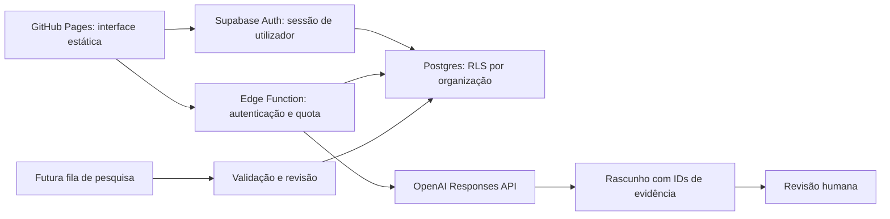

# Arquitetura e ativação

## Implementado e preparado

Frontend: HTML/CSS/JavaScript sem dependências, caminhos relativos compatíveis com uma subpasta de GitHub Pages, CSP sem scripts externos, conteúdo importado escapado. O build copia apenas `web/` para `dist/`. Catálogos e dados privados não são publicados.

Backend preparado: migração com organizações, membros, três gamas, catálogos, produtos, observações versionadas, acesso ao mercado, fila de pesquisa, auditoria e quota diária. RLS limita leitura a membros da organização. A interface não dispõe de políticas de escrita nem pode criar membros, aprovar evidência ou alterar quotas. Os membros iniciais são provisionados por administrador no servidor.

Função `market-brief`: rejeita origens não autorizadas, verifica a sessão com `getUser()`, confirma a organização e usa o cliente do próprio utilizador para aplicar RLS. Lê apenas observações revistas. Reserva no máximo 10 pedidos por utilizador/dia com uma operação SQL atómica, limita seleção e saída, define timeout de 30 segundos e omite erros/segredos do fornecedor. `AI_ENABLED=false` por omissão; o modelo é configuração explícita. A quota também conta tentativas que falhem no fornecedor, para conter utilização. Não usa a chave `service_role` para os pedidos do utilizador.

A IA não decide elegibilidade sanitária, não preenche lacunas, não calcula pontuações nem escreve na base. A saída é texto de rascunho com referências a IDs e sinalização de revisão. Não existem ferramentas de navegação ou execução no modelo. Evidências são dados não confiáveis, nunca instruções. Uma saída de IA não prova veracidade e os IDs citados devem ser conferidos antes de usar a conclusão.

## Ativar Supabase — etapa seguinte

1. Escolher projeto Supabase e aplicar a migração. Não há alterações remotas nesta entrega.
2. Criar utilizadores e uma organização; atribuir membros por administrador. Testar dois utilizadores de organizações diferentes, incluindo leitura negada e RPC negada.
3. Criar bucket privado para catálogos e políticas por organização antes de carregar ficheiros. O bucket/políticas Storage ainda não estão implementados.
4. Validar catálogos com página de origem e hash. Ingestão revista escreve no servidor, verifica pertença e adiciona auditoria. A ferramenta de ingestão ainda precisa de implementação.
5. Definir `OPENAI_API_KEY`, `OPENAI_MODEL`, `ALLOWED_ORIGINS` e `AI_ENABLED` nos segredos da função; nunca em Pages, variáveis do build, ficheiros públicos, Git ou mensagens de chat.
6. Publicar a função e testar 401, 403, quota, dados vazios, indisponibilidade e isolamento de organizações. Confirmar a configuração JWT do projeto. A migração e a função ainda não foram executadas num Supabase real.
7. Implementar login e adaptador de dados no frontend, substituir o estado em memória pela base e atualizar `connect-src` da CSP para o domínio exato do projeto. Manter renderização da saída como texto.

## Automações futuras

Nenhuma automação está ativa. `research_jobs` prepara estados, tentativas e chave de idempotência. Próxima implementação: worker com credencial de serviço restrita ao servidor, fontes autorizadas, validação de unidades e períodos, evidência versionada sem sobrescrever a revisão, retries com backoff, auditoria e passagem a `awaiting_review`. Agendamento deve disparar apenas a recolha; revisão permanece humana. Alertas surgem em alterações relevantes ou evidência desatualizada. Email/contactos externos só após aprovação explícita.

## Documentação consultada

- [OpenAI: autenticação e segredos no servidor](https://developers.openai.com/api/reference/overview)
- [OpenAI: Responses API](https://developers.openai.com/api/reference/responses/overview)
- [Supabase: RLS](https://supabase.com/docs/guides/database/postgres/row-level-security)
- [Supabase: sessão de utilizador nas Edge Functions](https://supabase.com/docs/guides/functions/auth-legacy-jwt)
- [GitHub: workflow de Pages](https://docs.github.com/en/pages/getting-started-with-github-pages/using-custom-workflows-with-github-pages)
